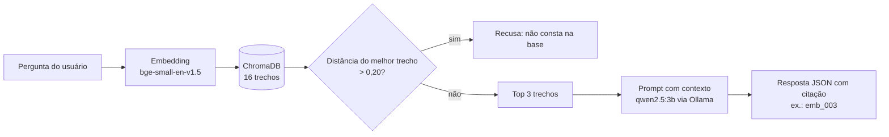

# AviRonda: assistente de ambiente de aviário com LLM local (RAG)

Projeto da Global Solution 2026.2 (FIAP, Engenharia de Software 4º ano), componente Inteligência (Generative AI for Engineering).

Vídeo: [LINK DO VÍDEO]

## Integrantes
| Integrante | RM |
|---|---|
| David Denunci | RM98603 |
| Fernando Popolili | RM99919 |
| Lucas de Toledo | RM97913 |
| Matheus Zanardi | RM98832 |
| Augusto Milreu | RM98245 |

## Problema e solução
Carrinho autônomo que faz ronda no aviário, mede calor e qualidade do ar e avisa o granjeiro. O carrinho mede temperatura, umidade e CO2 (sensor SCD40, que não mede amônia). A amônia entra na parte de IA como conhecimento de referência: o limite e os efeitos vêm das fontes da Embrapa, e o assistente não depende de medição de amônia pelo carrinho.

A parte de IA é um assistente que responde perguntas sobre ambiente de aviário com base em fontes da Embrapa e do INMET/El Niño. Quando a informação não consta na base, ele cita isso e recusa responder.

## Ficha técnica
- **Cidadão:** produtor avícola.
- **Problema:** calor e amônia podem prejudicar a saúde das aves e o desempenho.
- **Eixo:** segurança (saúde das aves e do trabalhador exposto à amônia).
- **Componentes de IA:** qwen2.5:3b via Ollama, embeddings bge-small-en-v1.5, ChromaDB.
- **ODS:** 2, 3 e 9.

## Pipeline de IA



## Base de conhecimento

| Fonte | Formato | Trechos |
|---|---|---|
| Embrapa (amônia, dark house, cama reutilizada, estresse calórico) | PDF | 9 |
| aviNews | HTML | 2 |
| Exame Agro | HTML | 1 |
| A Gazeta | HTML | 1 |
| UFSM | PDF | 1 |
| UNICAMP | PDF | 1 |
| Anais de congresso (Sousa-PB) | PDF | 1 |
| **Total** | | **16** |

*Direitos e uso:* os trechos são de fontes com direitos reservados aos seus titulares. Foram usados em pequenos trechos, com citação da fonte, apenas para fins acadêmicos neste trabalho, conforme o art. 46 da Lei 9.610/98. Nenhum conteúdo foi redistribuído.

## Como reproduzir

### Requisitos
1. Instale [Python 3.10+](https://www.python.org/) e o [Ollama](https://ollama.com/download).
2. Baixe o modelo:

```bash
ollama pull qwen2.5:3b
```

### Ambiente

Windows:
```bash
python -m venv .venv
.venv\Scripts\activate
pip install -r requirements.txt
```

Linux/macOS:
```bash
python3 -m venv .venv
source .venv/bin/activate
pip install -r requirements.txt
```

### Ordem de execução
1. Indexe a base:
```bash
python indexar.py
```
2. Teste uma pergunta:
```bash
python rag.py "Qual o limite de amônia recomendado para exportadores de frango?"
```
3. Rode as avaliações (opcional):
```bash
python baseline.py
python avaliar.py
python avaliar_agente.py
python recall.py
python placar.py
```

## API
Com o ambiente ativo, rode:
```bash
uvicorn api:app --reload
```

Depois acesse `http://127.0.0.1:8000/docs` para testar pelo navegador, ou use:
```bash
curl -X POST http://127.0.0.1:8000/perguntar \
  -H "Content-Type: application/json" \
  -d '{"pergunta": "Qual o limite de amônia recomendado para exportadores de frango?"}'
```

Exemplo de resposta:
```json
{"resposta": "20 ppm", "fonte": "emb_002", "encontrou": true}
```

## Notebook
`notebooks/avironda.ipynb` roda o pipeline de ponta a ponta (base, casos de teste, RAG e placar) com as saídas salvas. Abra o notebook no Jupyter a partir da pasta do projeto, com o ambiente ativo.

## Avaliação
- `baseline.py`: respostas da LLM sem contexto.
- `avaliar.py`: respostas com RAG.
- `avaliar_agente.py`: respostas com agente (reformula a pergunta e faz duas buscas).
- `placar.py`: compara as três configurações.
- `recall.py`: mede recall@1 e recall@3.
- `limiar.py`: mostra a distância do melhor trecho para cada caso, usada para escolher o limiar.

Casos de teste em `avaliacao/casos.jsonl`, inclusive um caso com resposta "não consta".

## Resultados (11 casos)

| Configuração | Acertos (10 automáticos) | Resposta completa e citada | Erros |
|---|---|---|---|
| Sem contexto | 0 | 0 | Respostas inventadas em todos os casos |
| RAG simples | 10 | 9 | c10: resposta certa, sem fonte citada |
| Agente | 9 | 8 | c03: só 36 ppm, faltam 29 e 78; c10: sem fonte citada |

- O caso c05 (efeitos do El Niño) é avaliado à mão e teve resposta correta nas três configurações.
- **JSON válido no RAG:** 11 de 11 casos.
- **Fonte correta no RAG:** 10 de 11 casos.
- **Recall@1 = 1,00 e recall@3 = 1,00** nos 10 casos com resposta na base.
- **Caso c08 reformulado:** a pergunta original repetia a resposta esperada e foi trocada por "A partir de que nível de amônia podem aparecer alterações nos pulmões dos frangos?" (esperado: 10 ppm). Por isso o RAG passou de 9/10 para 10/10. A mudança foi no caso de teste, não no sistema.
- **Limiar de recusa:** os casos respondíveis tiveram distância entre 0,10 e 0,20. Fixado em 0,20. O caso c04 ("não consta") tem distância 0,175, menor que a de alguns casos respondíveis. Por isso, o limiar sozinho não separa os casos; a recusa depende também do modelo gerador.
- **Variação entre execuções:** com temperatura 0, o modelo de 3B ainda varia entre rodadas, então 11 casos são uma amostra pequena.

## Limitações
- Os embeddings (bge-small-en-v1.5) são de um modelo em inglês usado com texto em português. Com 16 trechos o recall foi 1,00, mas isso não garante o mesmo em base maior; um modelo multilíngue deve ser testado como próximo passo.
- O caso c08 original tinha resposta esperada que apenas repetia a pergunta; foi reformulado (ver `avaliacao/casos.jsonl`) e os resultados foram regenerados.
- A comparação automática verifica o valor numérico; a resposta completa do c05 foi avaliada à mão.
- Modelo de 3B rodando em GPU de 6 GB.
- Base pequena (16 trechos) e 11 casos de teste.
- Parte do El Niño vem de notícias do setor, não do Painel El Niño oficial.
- O agente não superou o RAG simples nesse conjunto.
- As perguntas usam termos parecidos com os trechos, o que ajuda o recall.