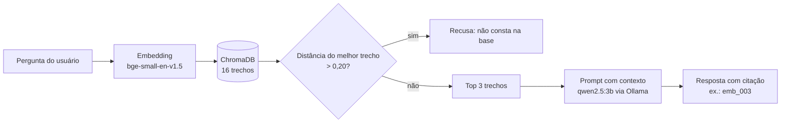

# AviRonda: assistente de ambiente de aviário com LLM local (RAG)

Projeto da Global Solution 2026.2 (FIAP, Engenharia de Software 4º ano), componente Inteligência (Generative AI for Engineering).

## Integrantes
| Integrante | RM |
|---|---|
| David Denunci | RM98603 |
| Fernando Popolili | RM99919 |
| Lucas de Toledo | RM97913 |
| Matheus Zanardi | RM98832 |
| Augusto Milreu | RM98245 |

## Problema e solução
Carrinho autônomo que faz ronda em aviário, mede calor e amônia e avisa o granjeiro. A parte de IA é um assistente que responde perguntas sobre ambiente de aviário com base em fontes da Embrapa e do INMET/El Niño, citando a fonte ou recusando quando a informação não consta na base.

## Ficha técnica
- **Cidadão:** produtor avícola.
- **Problema:** calor e amônia em aviários podem prejudicar a saúde das aves e o desempenho.
- **Componentes de IA:** LLM local (qwen2.5:3b via Ollama), embeddings (BAAI/bge-small-en-v1.5), ChromaDB.
- **Fontes:** Embrapa (amônia, estresse calórico, ventilação), aviNews e Exame Agro (El Niño).
- **ODS:** 2 (fome zero e agricultura sustentável), 3 (saúde e bem-estar), 9 (indústria, inovação e infraestrutura).

## Como reproduzir
1. Instale [Python 3.10+](https://www.python.org/) e o [Ollama](https://ollama.com/download).
2. Baixe o modelo: `ollama pull qwen2.5:3b`
3. Crie o ambiente:

- python -m venv .venv
- .venv\Scripts\activate
- pip install ollama chromadb sentence-transformers pandas

4. Indexe a base: `python indexar.py`
5. Teste uma pergunta: `python rag.py "Qual o limite de amônia recomendado para exportadores de frango?"`

## Avaliação
- `baseline.py`: respostas da LLM sem contexto.
- `avaliar.py`: respostas com RAG.
- `avaliar_agente.py`: respostas com agente (reformula a pergunta e faz duas buscas).
- `placar.py`: compara as três configurações.
- `recall.py`: mede recall@1 e recall@3.
- `limiar.py`: mostra a distância do melhor trecho para cada caso, usada para escolher o limiar.

Casos de teste em `avaliacao/casos.jsonl`, inclusive um caso com resposta "não consta".

## Resultados (11 casos)

| Configuração | Valor correto (10 casos automáticos) | Resposta completa e citada | Observação |
|---|---|---|---|
| Sem contexto | 1 | 0 | Acerta o c08 por acaso; inventa valores nos demais |
| RAG simples | 9 | 8 | Erros: c08 (sem o limiar de 20 ppm), c10 (fonte não citada) |
| Agente | 9 | 8 | Erro: c03 (resposta incompleta, só 36 ppm) |

- O caso c05 (efeitos do El Niño) é avaliado à mão e teve resposta correta nas três configurações.
- **JSON válido no RAG:** 11 de 11 casos.
- **Fonte correta no RAG:** 10 de 11 casos.
- **Recall@1 = 1,00 e recall@3 = 1,00** nos 10 casos com resposta na base.
- **Limiar de recusa:** as menores distâncias dos casos respondíveis ficaram entre 0,10 e 0,20. Fixado em 0,20. O caso c04 ("não consta") tem distância 0,175, menor que a de alguns casos respondíveis. Por isso, o limiar sozinho não separa os casos; a recusa depende também do modelo gerador.
- **Variação entre execuções:** o agente errou o c03 nesta rodada, que o RAG acertou. Com temperatura 0, o modelo de 3B ainda varia, o que limita a comparação com 11 casos.

### Recall da busca
Recall@1 e recall@3 = 1,00 nos 10 casos com resposta na base.

### Limiar de recusa
A menor distância dos casos respondíveis ficou entre 0,10 e 0,20. O limiar foi fixado em **0,20**. Acima disso, o sistema recusa sem chamar a LLM.

Limitação: esse limiar não separa sozinho os casos. O caso c04 ("não consta") tem distância 0,175, menor que a de alguns casos respondíveis. A recusa desse caso depende do modelo gerador, não só do limiar.

## Limitações
- Modelo de 3B parâmetros, rodando em GPU de 6 GB.
- Base pequena (16 trechos) e conjunto de teste com 11 casos.
- Parte do El Niño vem de notícias do setor, não do Painel El Niño oficial.
- O agente não superou o RAG simples nesse conjunto.
- O conjunto de teste é pequeno, e as perguntas usam termos próximos dos trechos, o que favorece o recall.

## Pipeline de IA

